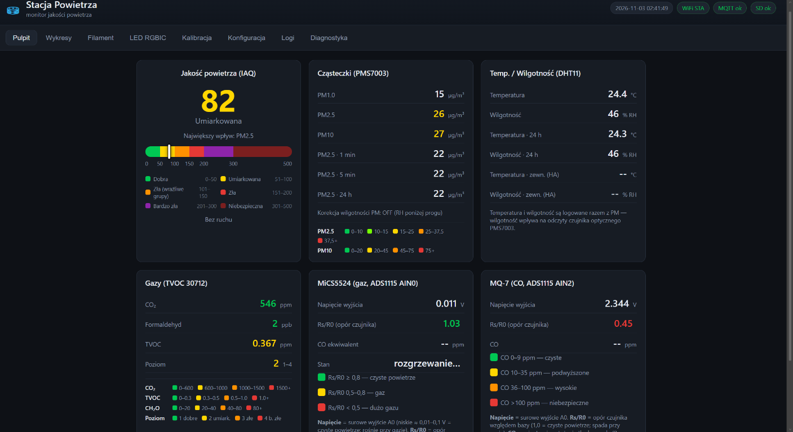
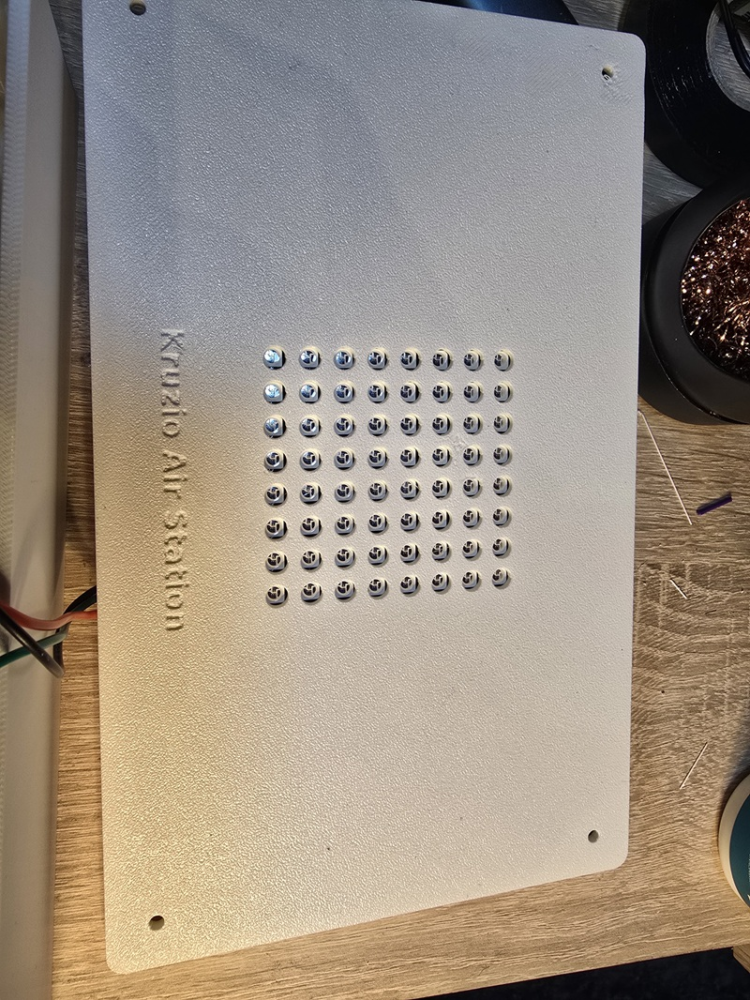
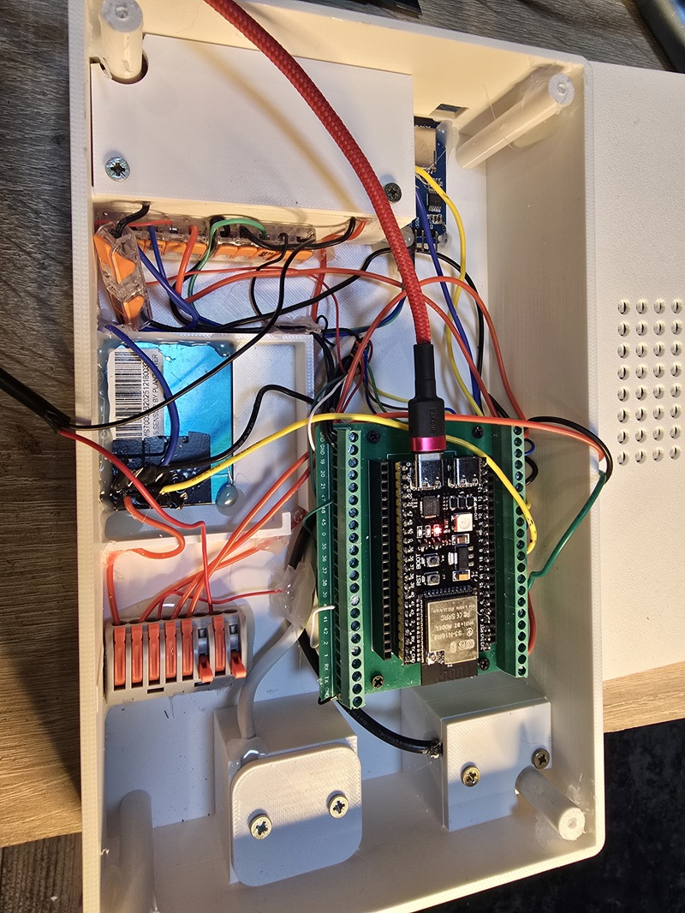
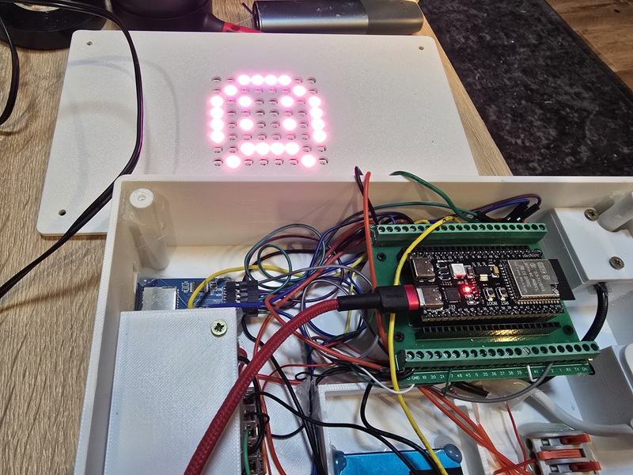

# 🌬️ Air Station Inside — stacja jakości powietrza

> 🇵🇱 [Polska wersja](#polski) &nbsp;·&nbsp; 🇬🇧 [English version](#english)
>
> *Autor / Author: **kruzio1985*** · [github.com/kruzio1985](https://github.com/kruzio1985)
> *Licencja / Licence: [PolyForm Noncommercial License 1.0.0](LICENSE)*

Stacja monitorowania jakości powietrza na **ESP32-S3 WROOM-1 N16R8** z interfejsem WWW,
wysyłką do **Home Assistant** przez MQTT (auto-discovery), logowaniem na karcie **microSD**
oraz **matrycą LED 8×8** jako wskaźnikiem jakości powietrza.

---

## 🖼️ Zdjęcia / Photos

**Pulpit — przegląd czujników na żywo / Dashboard — live sensor overview**



| Obudowa / Enclosure | Elektronika / Electronics | Matryca LED / LED matrix |
|---|---|---|
|  |  |  |

---

## 🖨️ Obudowa 3D / 3D enclosure

Model obudowy stacji jest dostępny na MakerWorld:

🔗 **https://makerworld.com/pl/models/3538412-air-station-home-pms7003-and-other-sensors**

---

<a id="polski"></a>
## 🇵🇱 Polski — pełny opis

Monitor powietrza przy drukarce 3D. Urządzenie mierzy pyły zawieszone, gazy i parametry
powietrza, pokazuje jakość na stronie WWW i na matrycy LED, a dane wysyła do Home Assistant.

### Funkcje

- **Pulpit na żywo** — wskaźnik IAQ (0–500), PM1.0/PM2.5/PM10, CO₂, formaldehyd (CH₂O),
  TVOC (ppm + poziom 1–4), CO (MiCS-5524 i MQ-7), temperatura i wilgotność, ruch.
- **Wykresy** — historia minutowa (co 5 min na SD, ring buffer 24 h w PSRAM, odtworzenie po starcie).
- **Filament** — 16 pojemników z czujnikami AHT20 przez węzeł Zigbee (MQTT `filamentnode/box/N/…`),
  progi wilgotności, stany suchy / uwaga / mokry.
- **LED RGBIC** — 16 efektów: kolor jakości powietrza, buźki (🙂😐☹️🤢), cyfry AQI/PM2.5,
  poziom jakości, tekst przewijany, tęcza, ogień, plasma, matrix rain, kometa, iskry, auto-cykl.
- **Kalibracja** — zapis R0 dla MiCS-5524 i MQ-7, sterowanie grzałką (EN, GPIO11).
- **Konfiguracja** — Wi-Fi, MQTT/Home Assistant, korekcja wilgotnościowa PM,
  LED (układ/obrót/kolejność kolorów/jasność), PIR, opisy pojemników.
- **Home Assistant** — auto-discovery 26 sensorów + zbiorczy JSON jakości powietrza (retained).
- **Logi i diagnostyka** — syslog, reset reason, pamięć, RSSI, stan karty SD.
- **Aktualizacje** — OTA (Wi-Fi/USB) i wgrywanie plików strony bezprzewodowo (`/api/file`).

### Obecnie zamontowane moduły

| Moduł | Interfejs | Piny | Rola |
|---|---|---|---|
| PMS7003 | UART2, 9600 b/s | RX=18, TX=17 | PM1.0 / PM2.5 / PM10 (wartości atmosferyczne) |
| Waveshare TVOC (SKU 30712) | UART1, 115200 b/s | RX=14, TX=15 | CO₂, formaldehyd CH₂O, TVOC, poziom 1–4 |
| ADS1115 + MiCS-5524 | I2C, 0x48, AIN0 | SDA=8, SCL=9 | ekwiwalent CO, Rs/R0 |
| ADS1115 + MQ-7 | AIN2 | SDA=8, SCL=9 | CO (orientacyjnie) |
| SHT31 | I2C #2 (Wire1) | SDA=47, SCL=40 | temperatura i wilgotność |
| Karta microSD | SPI | SCK=4, MOSI=5, MISO=6, CS=2 | logowanie CSV (co 5 min) |
| Matryca LED 8×8 WS2812B | 1-wire | GPIO 7 | wskaźnik jakości powietrza |
| PIR (AM312 / SR505) | GPIO | 21 | detekcja ruchu (opcjonalny, odpinany) |

> DHT11 został **usunięty** — zastąpiony czujnikiem SHT31.

### Budowanie i wgrywanie

```
pio run -e esp32s3 -t upload     # firmware (USB)
pio run -e esp32s3 -t uploadfs   # strona WWW (LittleFS)
pio run -e esp32s3-ota -t upload --upload-port <IP>   # aktualizacja przez Wi-Fi
```

Pierwsze uruchomienie bez zapisanej sieci: stacja startuje jako punkt dostępowy
**FilamentMonitor** / hasło AP → `http://192.168.4.1` → zakładka **Konfiguracja**.

### REST API

`/api/status` · `/api/config` · `/api/history` · `/api/led` · `/api/calibrate` ·
`/api/calibrate_mq7` · `/api/heater` · `/api/diag` · `/api/syslog` · `/api/file` ·
`/api/ota` · `/api/sd/list|file|delete` · `/api/reboot` · `/api/factory`

---

<a id="english"></a>
## 🇬🇧 English — full description

An air-quality monitor for a 3D-printer station. The device measures particulate matter,
gases and air parameters, shows the quality on a web page and an 8×8 LED matrix,
and publishes everything to Home Assistant.

### Features

- **Live dashboard** — IAQ index (0–500), PM1.0/PM2.5/PM10, CO₂, formaldehyde (CH₂O),
  TVOC (ppm + level 1–4), CO (MiCS-5524 and MQ-7), temperature and humidity, motion.
- **Charts** — minute history (stored on SD every 5 min, 24 h ring buffer in PSRAM,
  restored after boot).
- **Filament** — 16 boxes with AHT20 sensors via a Zigbee node (MQTT `filamentnode/box/N/…`),
  humidity thresholds, dry / warning / wet states.
- **LED RGBIC** — 16 effects: air-quality colour, smileys (🙂😐☹️🤢), AQI/PM2.5 digits,
  quality level, scrolling text, rainbow, fire, plasma, matrix rain, comet, sparkles, auto-cycle.
- **Calibration** — R0 storage for MiCS-5524 and MQ-7, heater control (EN, GPIO11).
- **Configuration** — Wi-Fi, MQTT/Home Assistant, PM humidity correction,
  LED (layout/rotation/colour order/brightness), PIR, box descriptions.
- **Home Assistant** — auto-discovery of 26 sensors + a retained air-quality JSON payload.
- **Logs & diagnostics** — syslog, reset reason, memory, RSSI, SD-card state.
- **Updates** — OTA (Wi-Fi/USB) and wireless web-file upload (`/api/file`).

### Currently installed modules

| Module | Interface | Pins | Role |
|---|---|---|---|
| PMS7003 | UART2, 9600 b/s | RX=18, TX=17 | PM1.0 / PM2.5 / PM10 (atmospheric values) |
| Waveshare TVOC (SKU 30712) | UART1, 115200 b/s | RX=14, TX=15 | CO₂, CH₂O, TVOC, level 1–4 |
| ADS1115 + MiCS-5524 | I2C, 0x48, AIN0 | SDA=8, SCL=9 | CO equivalent, Rs/R0 |
| ADS1115 + MQ-7 | AIN2 | SDA=8, SCL=9 | CO (indicative) |
| SHT31 | I2C #2 (Wire1) | SDA=47, SCL=40 | temperature and humidity |
| microSD card | SPI | SCK=4, MOSI=5, MISO=6, CS=2 | CSV logging (every 5 min) |
| 8×8 WS2812B LED matrix | 1-wire | GPIO 7 | air-quality indicator |
| PIR (AM312 / SR505) | GPIO | 21 | motion detection (optional, detachable) |

> The DHT11 was **removed** — replaced by the SHT31.

### Build & flash

```
pio run -e esp32s3 -t upload     # firmware (USB)
pio run -e esp32s3 -t uploadfs   # web UI (LittleFS)
pio run -e esp32s3-ota -t upload --upload-port <IP>   # over-the-air update
```

First boot without a saved network: the station starts an access point
**FilamentMonitor** / AP password → `http://192.168.4.1` → **Configuration** tab.

### REST API

`/api/status` · `/api/config` · `/api/history` · `/api/led` · `/api/calibrate` ·
`/api/calibrate_mq7` · `/api/heater` · `/api/diag` · `/api/syslog` · `/api/file` ·
`/api/ota` · `/api/sd/list|file|delete` · `/api/reboot` · `/api/factory`